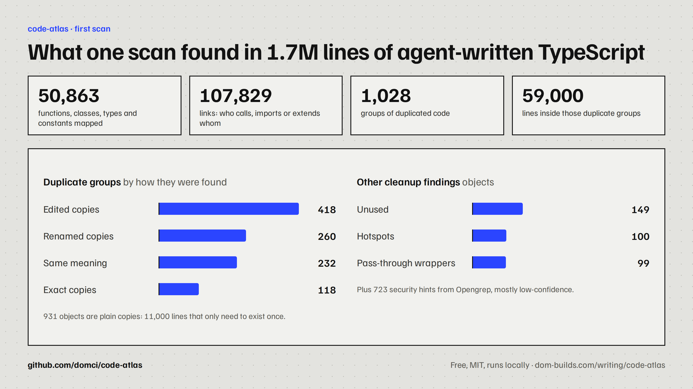
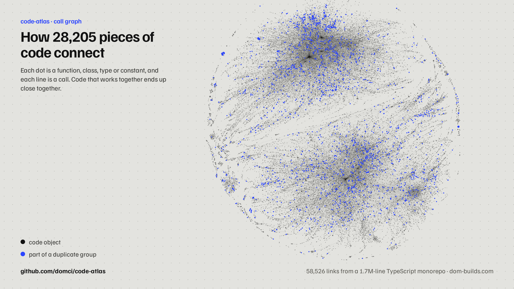

# code-atlas

**Find the copy-paste, dead code and risky hotspots in a TypeScript codebase, and hand the list to your coding agent.**

AI coding agents write code fast. They also write the same helper five times, under five names, in five folders.
code-atlas finds that. It reads every function, method, class, type and constant in your repo, works out how they connect,
and returns a ranked list of what to clean up. Every command prints JSON, so an agent can read the list, fix one item,
and scan again.

- **Duplicates, four ways.** Exact copies, copies with renamed variables, copies with small edits, and different code that does the same thing.
- **Unused code** that nothing calls, imports or references.
- **Hotspots.** Complex code that changes often and that a lot of other code depends on.
- **Pass-through wrappers** that only forward their arguments to another function.
- **Security hints** from [Opengrep](https://github.com/opengrep/opengrep), tied to the function they sit in.
- **Full CSV lists** of every finding, every code object and every link.

Everything runs on your machine. No API keys, no cloud, no code leaves your computer.

The story behind it: [I scanned 1.7 million lines of agent-written code for copies](https://dom-builds.com/writing/code-atlas).

## What it found on a real codebase



The first run was on a production TypeScript monorepo: 8,000 files, 1.7 million lines, and a lot of agent-written code.

| | |
| --- | --- |
| Code objects mapped | **50,863** |
| Links between them (calls, imports, extends …) | **107,829** |
| Duplicate groups | **1,028**, covering 2,612 objects and 59,000 lines |
| Plain copies (exact or renamed) | **931 objects**, 11,000 lines |
| Unused functions, classes and types | **127** |
| Hotspot files | **100** |
| Pass-through wrappers | **74** |
| Security hints | **723**, mostly low-confidence hints to review |
| First scan / repeat scan | 43 min (code embeddings on CPU) / **35 s** |

Some real finds:

- the same 115-line function in two different apps;
- 8 copies of the same `sha256` helper;
- 17 copies of one 5-line lookup helper;
- 7 copies of one number parser, each under a different name;
- an entire generated file that nothing imports.

## How it works




```mermaid
flowchart LR
  repo[(your repo)] --> gn[GitNexus index<br/>symbols + call graph]
  gn --> scan[atlas scan]
  repo --> scan
  git[(git history)] --> scan
  scan --> fp[fingerprints<br/>exact / renamed / edited]
  scan --> emb[local code embeddings<br/>same meaning]
  scan --> graph[graph checks<br/>unused, hotspots]
  fp & emb & graph --> db[(SQLite atlas)]
  og[Opengrep / knip reports] -->|atlas import| db
  db --> agent[your coding agent<br/>atlas debt / show / sql]
```

1. **The map.** [GitNexus](https://github.com/abhigyanpatwari/GitNexus) parses the repo into a graph: every code object, and which one calls, imports or extends which. code-atlas reads that graph read-only.
2. **Fingerprints.** Each body is tokenised with the TypeScript compiler. Three fingerprints per body:
   - **exact:** the same tokens (its own name ignored);
   - **renamed:** all names and values blanked out;
   - **edited:** a MinHash of 5-token runs, so copies with a few changed lines still match.
3. **Meaning.** Each body and each name is embedded with [jina-embeddings-v2-base-code](https://huggingface.co/jinaai/jina-embeddings-v2-base-code), locally on the CPU. Bodies above 0.95 cosine similarity are the same logic in different words. Names count too: `formatPrice` and `priceToLabel` lower the bar.
4. **Graph checks.**
   - **Unused:** no use in the graph, and the name appears nowhere else in the code. The second check catches functions passed as values, like `onClick={save}`, which call graphs miss.
   - **Hotspots:** branches × recent commits × number of users, summed per file. One finding per file lists its complex functions.
5. **One ranked list** in a SQLite file, plus anything you import from Opengrep, Semgrep or knip.

### Noise control

A first run on a real repo found a lot of noise. These rules removed it:

- Data tables, config objects and label lists only count when copied exactly. Same shape with other values is not duplication.
- Loosely similar code that chains into a big group (a~b, b~c, c~d, …) is reported once as a repeated pattern, at lower weight.
- Framework entry points (Next.js `page`, `route`, `layout`, `GET`/`POST` handlers, config files) are never "unused".
- Object members such as `{ onSave: () => … }` are called by a library, so they are skipped too.
- Also never "unused": default exports (imported under any name), interfaces merged into `declare global` or `declare module` (`Window`, `Locals`), exports of a file imported as a namespace outside tests (`import * as schema`, as Drizzle needs), and methods of a class that extends or implements something (React lifecycle, reporter hooks).
- Names in Markdown, and in MDX under `docs/` or `plans/`, do not count as a use.
- A wrapper is a function declaration whose body forwards its own parameters. Values built by a call (`z.object(…)`, `cache(…)`), object constants, type guards and route handlers are not wrappers.
- Test files are left out of duplicates. Security hits in tests rank low.
- Files ignored by git are skipped, even when the index contains them.

## Quick start

You need [Bun](https://bun.sh) 1.4+, git, and [GitNexus](https://github.com/abhigyanpatwari/GitNexus) (tested with 1.6.9).

```sh
git clone https://github.com/domci/code-atlas && cd code-atlas
bun install
bun link                      # puts `atlas` on your PATH

cd /path/to/your/repo
npx gitnexus analyze          # build the code graph (about 1–2 min for a large repo)
atlas scan                    # first run downloads the code model and embeds everything
atlas debt --limit 20         # the 20 worst items
```

## Commands

| Command | What you get |
| --- | --- |
| `atlas scan [--no-embed]` | Rebuild the atlas. `--no-embed` skips the meaning check and runs in seconds. |
| `atlas debt [--kind k] [--path p] [--min n] [--limit n]` | Ranked findings. `--limit 0` returns all of them. |
| `atlas show <id>` | One finding with every copy, its file and line. |
| `atlas symbol <name>` | Where a name is defined, its numbers, its findings. |
| `atlas similar <name>` | Code that does the same thing as `<name>`. |
| `atlas sql "<select …>"` | Any other question, read-only. |
| `atlas export [dir]` | `findings.csv`, `symbols.csv`, `edges.csv`: the full lists. |
| `atlas new` | New exact/renamed copies in changed files (vs HEAD, plus untracked) against the last scan. Plain text; silent when none, no scan, over 5 s or on error; exit 0. |
| `atlas import sarif <file>` | Add Opengrep, Semgrep or CodeQL results. |
| `atlas import knip <file> --base <dir>` | Add knip results (unused files, exports, dependencies). |

Example (shortened):

```console
$ atlas debt --kind duplicate --limit 2
[
 { "id": 12, "kind": "duplicate-renamed", "score": 90,
   "title": "17 copies of projectOf (renamed, 80 extra lines)", "file": "app/projects/[id]/orders/actions.ts", "line": 19 },
 { "id": 31, "kind": "duplicate-edited", "score": 79,
   "title": "7 copies of euroCents (edited, 66 extra lines)", "file": "server/articles/articles.ts", "line": 29 }
]
```

## Finding kinds

| Kind | Meaning |
| --- | --- |
| `duplicate-exact` | The same code under another name. |
| `duplicate-renamed` | The same code with renamed variables or other values. |
| `duplicate-edited` | A copy with small edits (≥ 80% of 5-token runs shared). |
| `duplicate-meaning` | Different code, same meaning (embedding cosine ≥ 0.95, or ≥ 0.88 when the names mean the same). |
| `unused` | No calls, imports or references anywhere. Exported ones may be used by other packages; check before deleting. |
| `hotspot` | Complex, changed often in the last 180 days, and used by a lot of code. |
| `wrapper` | Only forwards its parameters to another call. |
| `security` | Imported from SARIF (Opengrep, Semgrep, CodeQL). |
| `knip-*` | Imported from knip. |

## Use it with a coding agent

Add this to your `AGENTS.md` or `CLAUDE.md`:

```md
## Code cleanup
- `atlas debt --limit 20` lists the worst duplicates, unused code and hotspots (JSON).
- `atlas show <id>` gives every copy with file and line.
- Before you change a shared function, run `gitnexus impact <name>`.
- Fix one finding, run the tests, then `atlas scan` again.
```

The agent then works through the list. No subagents and no vector database are needed, only shell commands.

### Stop hook: warn about a copy right after the agent writes it

`hooks/stop.ts` runs `atlas new` once per turn (nothing when the repo has no scan) and, if it finds new copies, blocks the stop with them as the reason. The agent may ignore them with a one-line reason; the second stop of a turn (`stop_hook_active`) passes. Rescan nightly so "new" stays recent; scans made before `atlas new` existed stay silent until the next `atlas scan`.

- **Claude Code**, `~/.claude/settings.json`: `"hooks": { "Stop": [{ "hooks": [{ "type": "command", "command": "bun ~/repos/code-atlas/hooks/stop.ts 2>/dev/null || true", "timeout": 10 }] }] }`
- **Codex**, `~/.codex/hooks.json` (needs `[features] hooks = true`): the same `Stop` entry; trust it once in Codex with `/hooks`.
- **OpenCode** has no blocking stop, so `hooks/opencode.js` is a plugin: when a root session goes idle with new copies, it sends them to the session as a prompt, once per turn. Install: `ln -s ~/repos/code-atlas/hooks/opencode.js ~/.config/opencode/plugins/code-atlas.js`.
- Test: copy a scanned function into a new file, then `echo '{"stop_hook_active":false}' | bun hooks/stop.ts` prints `{"decision":"block",…}`.

## Security scan

```sh
git clone --depth 1 https://github.com/opengrep/opengrep-rules ~/.cache/code-atlas/opengrep-rules
R=~/.cache/code-atlas/opengrep-rules
opengrep scan --sarif-output=/tmp/og.sarif \
  $(find $R/javascript $R/typescript -type d -name security | sed 's/^/--config /') .
atlas import sarif /tmp/og.sarif
```

Use only the `security` rule folders. The full rule set is mostly style and translation hints.

## Pictures for your own repo

`docs/findings-chart.html` and `docs/network-graph.html` are the sources of the two images above.

```sh
bun docs/network-layout.ts ~/.cache/code-atlas/<repo>-<hash>.db /tmp/network.json   # force layout, ~90 s for 28k nodes
```

Then open `docs/network-graph.html`, call `draw(<the JSON>)` in the browser console, and screenshot it.

## Data

One SQLite file per repo in `~/.cache/code-atlas/`, outside your repo. Tables for `atlas sql`:

- `symbols(id, kind, name, file, start_line, end_line, lines, exported, test, community, community_label, fan_in, fan_out, churn, branches, tokens, code_key)`
- `edges(src, dst, type)`: CALLS, IMPORTS, ACCESSES, EXTENDS, IMPLEMENTS, …
- `pairs(a, b, kind, score)`: every duplicate pair.
- `findings(id, source, kind, score, title, file, line, ids, detail)`: `ids` and `detail` are JSON.

## Limits

- Duplicates are found per whole function, not per copied block inside one. [jscpd](https://github.com/kucherenko/jscpd) covers blocks.
- The meaning check compares every pair of bodies on all CPU cores: about 20 s for 25,000 bodies. Beyond about 100,000 bodies it needs an approximate index.
- "Unused" relies on the graph plus a name search. A name that is reused elsewhere hides a finding, but never invents one.
- The first scan embeds every body on the CPU. Later scans only embed new or changed code.

## Thanks

Built on [GitNexus](https://github.com/abhigyanpatwari/GitNexus) (graph, note its own licence), [LadybugDB](https://github.com/LadybugDB/ladybug),
[Transformers.js](https://github.com/huggingface/transformers.js), [Jina code embeddings](https://huggingface.co/jinaai/jina-embeddings-v2-base-code),
[Opengrep](https://github.com/opengrep/opengrep) and the TypeScript compiler.

## License

MIT
